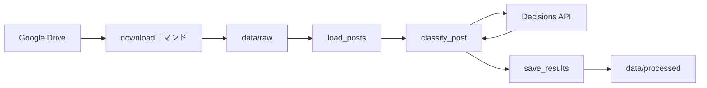

# コードの読み方と変更パターン

## 設計の単位

2人が変更箇所を把握しやすいよう、機能ごとに1ファイルから始めます。
共有基盤クラスや抽象ファクトリーは導入せず、関数と辞書でつなぎます。

| ファイル | 責務 |
| --- | --- |
| [main.py](./src/instagram_analysis/main.py) | 設定読込、CLI、処理の順序、クライアント生成 |
| [drive_data.py](./src/instagram_analysis/drive_data.py) | Drive取得とローカルパス参照 |
| [instagram.py](./src/instagram_analysis/instagram.py) | CSV読込と入力の検証・空白除去 |
| [decisions.py](./src/instagram_analysis/decisions.py) | 質問と選択肢、API呼出し、回答検証 |
| [storage.py](./src/instagram_analysis/storage.py) | 既存ファイルを上書きしないCSV保存 |



## 関数の境界

- 読み込み関数は投稿の辞書一覧を返します。投稿IDは文字列です。
- 分類関数は1投稿を受け取り、保存用の辞書を返します。
- OpenAIクライアントはCLIで一度生成し、分類関数へ渡します。
  検証時には同じ形の偽クライアントに置き換えられます。
- 保存関数は反復可能な結果を受け取ります。CLIではジェネレーターを渡し、
  1件分類するたびに書き込むため、後続の通信失敗で成功済みの結果を失いません。
- 既存出力を開けない場合、ジェネレーターは実行されずAPI呼出しも発生しません。
- 例外は処理を止めます。エラーを成功データや空の分類に置き換えません。
  APIの判定拒否は有効な応答として記録します。

## よくある変更

### Driveから取得したファイルを参照する

```python
from instagram_analysis.drive_data import get_data_path, sync_drive_data

sync_drive_data()
posts_path = get_data_path("posts.csv", sync=False)
```

保存先は `GOOGLE_DRIVE_DATA_DIR`、既定はカレントディレクトリ基準の
`data/raw`です。`get_data_path`はキャッシュ外を指すパスを拒否します。
`sync=False`を省くと参照ごとにDriveへアクセスします。

### CSVの列名を合わせる

まず [instagram.py](./src/instagram_analysis/instagram.py) の読込処理を変更します。
他のモジュールへ渡す `post_id` と `text` は維持すると、分類・保存処理を
変えずに済みます。外部CSVの実際の列と内部名の対応をREADMEへ追記します。

### 分類基準を変える

[decisions.py](./src/instagram_analysis/decisions.py) の `QUESTIONS` にある
説明と選択肢を変更し、`CRITERIA_VERSION`も更新します。
区分の追加だけなら保存形式を変更する必要はありません。
新しい質問を増やす場合は回答処理と [storage.py](./src/instagram_analysis/storage.py)
の保存列も更新します。既存結果は再評価時の比較用に残します。

### MLを追加する

十分なデータと人の確認ラベルが揃ってから、特徴量生成を `features/`、
学習・評価を `ml/` に置きます。APIの予測値をそのまま正解ラベルとみなさず、
元投稿と確認済みラベルを投稿IDで対応させます。

## Pythonの書き方

- PEP 8に沿い、行長79文字・4スペースのインデントを使います。
- Ruffの設定と依存関係は [pyproject.toml](./pyproject.toml) に集約します。
- 関数名は `snake_case`、定数は大文字、パスは `pathlib.Path` を使います。
- 引数と戻り値に型ヒントを付けます。
- docstringは日本語のGoogleスタイルです。引数があれば `Args:`、戻り値が
  あれば `Returns:`、呼び出し側が扱う例外があれば `Raises:` を書きます。

```python
def normalize_text(text: str) -> str:
    """投稿本文の前後の空白を除去する。

    Args:
        text: 入力された投稿本文。

    Returns:
        前後の空白を除去した本文。
    """
    return text.strip()
```

初期構成ではCSVに保存します。画像処理・Parquet・学習の実装はまだありません。
環境構築、運用、データの保存列は [README.md](./README.md) を参照してください。
